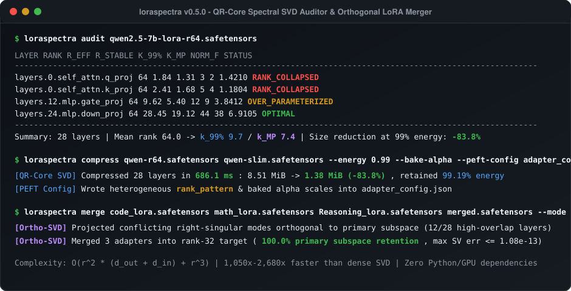
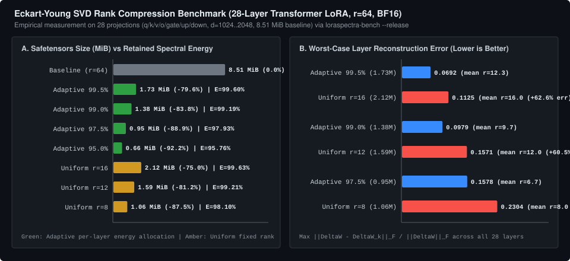
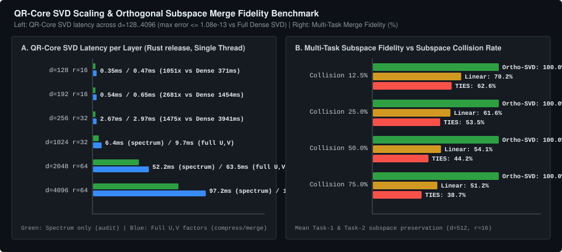

# loraspectra

**Spectral SVD Auditor, Silent SFT Integrity Checker, Eckart-Young Dynamic Rank Compressor, and Orthogonal Subspace Merger for `.safetensors` LoRA Adapters.**

> **[Launch the Interactive Browser `.safetensors` Spectral SVD Inspector -> `https://salyys1.github.io/loraspectra/`](https://salyys1.github.io/loraspectra/)**
> *Drop any PEFT, Kohya/ComfyUI, FLUX, or Diffusers `.safetensors` LoRA directly into your browser - 100% client-side QR-Core SVD, zero file uploads, interactive Target Energy slider (`90%` to `99.9%`), Gavish-Donoho Marchenko-Pastur noise floor visualization, and 1-click synthetic demos.*

`loraspectra` (`v0.9.0`) is a zero-dependency Rust engine, CLI, and client-side Web Inspector for auditing, diagnosing, comparing, compressing, and merging Low-Rank Adaptation (LoRA / DoRA) weights stored in HuggingFace `.safetensors` format (`F32`, `F16`, and `BF16`) without loading a multi-gigabyte PyTorch or GPU runtime.

Instead of materializing dense update matrices $\Delta W = B A \in \mathbb{R}^{d_{\text{out}} \times d_{\text{in}}}$ and running cubic $O(d^3)$ Singular Value Decomposition, `loraspectra` factors $B = Q_B R_B$ and $A^T = Q_A R_A$ via Modified Gram-Schmidt with Daniel-Gragg-Kaufman-Stewart (DGKS) re-orthogonalization and solves the exact SVD on the tiny $r \times r$ core matrix $M = R_B R_A^T$. This reduces per-layer spectral complexity from $O(d^3)$ to $O(r^2(d_{\text{out}} + d_{\text{in}}) + r^3)$ - delivering a **1,050x to 2,680x speedup** over full dense SVD while matching singular values to within **$1.08 \times 10^{-13}$** (IEEE 754 `f64` machine precision).



---

## Core Capabilities

1. **Zero-Download-Friction HuggingFace Hub & Remote URL Inspection (`hf://org/repo`)**
   - Pass `hf://<org>/<repo>`, `hf://<org>/<repo>/<lora.safetensors>`, or any `https://.../*.safetensors` URL directly to `info`, `audit`, `card`, `compress`, `interference`, `merge`, or `extract`.
   - Automatically discovers the `.safetensors` LoRA file (and optional companion `adapter_config.json`) via the HuggingFace Hub API siblings list, respects `HF_TOKEN` for gated/private repos, and caches weights in `${TMPDIR:-/tmp}/loraspectra-cache/` so subsequent runs are instant.

2. **Adapter Integrity & Silent Fine-Tuning Bug Diagnostics (`loraspectra audit [--json]`)**
   - **Zero-Norm / Dead Special-Token Embedding Detection**: Inspects saved dense token matrices (`embed_tokens`, `wte`, `lm_head` via `modules_to_save`) and LoRA adapters targeting them (including PEFT `lora_embedding_A` / `lora_embedding_B` and `lm_head` `lora_B`), flagging zero/near-zero token rows and dead `lora_B` rank columns. Catches the silent Qwen2.5-Coder / Llama SFT bug where newly added `<tool_call>` special tokens never receive gradient updates.
   - **Alpha & DoRA Scaling Anomaly Detection**: Flags missing `lora_alpha` in `adapter_config.json` when `.alpha` scalar tensors are absent, partial or mismatched `.alpha` coverage across layers, extreme `alpha/r` ratios (`< 0.1` silent under-scaling or `> 16.0` norm explosion during merge), and missing or shape-mismatched DoRA magnitude vectors.

3. **HuggingFace Model Card Spectral Audit Generator (`loraspectra card <adapter_or_hf_uri>`)**
   - Generates a ready-to-paste Markdown Spectral Audit Report for HuggingFace `README.md` Model Cards from any local path or `hf://org/repo` URI.
   - Includes static `shields.io` spectral rank and integrity badges, a summary metrics table (total LoRA parameters, nominal vs effective/stable rank, mean 99% Frobenius energy utilization, optimal Eckart-Young compression rank, DoRA/alpha health check), and a table of top capacity-bottleneck vs over-parameterized target modules.

4. **Interactive 100% Client-Side Browser `.safetensors` Inspector ([`salyys1.github.io/loraspectra`](https://salyys1.github.io/loraspectra/))**
   - Drag-and-drop any `.safetensors` LoRA file locally in your browser (zero uploads, zero external CDNs) or explore built-in 1-click presets (`Rank-64 Collapsed PEFT Transformer LoRA` vs `Healthy Rank-16 FLUX/Kohya Style LoRA`).
   - Runs genuine QR-Core + One-Sided Jacobi SVD in JavaScript, featuring live Target Energy (`90%` to `99.9%`) size-savings previews, interactive SVG singular spectrum charts with Gavish-Donoho $\tau^*$ noise floors, sortable layer tables, and copyable CLI commands.

5. **Spectral Rank-Collapse, Entropy & Marchenko-Pastur Audit (`loraspectra audit`)**
   - Computes exact singular value spectra $\sigma_1 \ge \sigma_2 \ge \dots \ge \sigma_r$ for every `(lora_A, lora_B)` pair in a `.safetensors` archive across HuggingFace PEFT, Kohya/ComfyUI, Diffusers, and OneTrainer naming conventions.
   - Reports Spectral Norm ($\|\Delta W\|_2 = \sigma_1$), Frobenius Norm ($\|\Delta W\|_F$), Stable Rank ($r_{\text{stable}} = \|\Delta W\|_F^2 / \sigma_1^2$), von Neumann Spectral Entropy Effective Rank ($r_{\text{eff}} = \exp(-\sum_i p_i \ln p_i)$), cumulative energy ranks ($k_{90\%}, k_{95\%}, k_{99\%}$), and the **Gavish-Donoho (2014) Marchenko-Pastur optimal hard-threshold signal rank (`K_MP`)**.
   - Flags `RANK_COLLAPSED` ($r_{\text{eff}} < 2.0$ or $k_{99\%}/r \le 0.15$), `OVER_PARAMETERIZED` ($k_{99\%}/r \le 0.55$), `DEAD_LAYER`, and `OPTIMAL` projections.

6. **Eckart-Young-Mirsky & Marchenko-Pastur Dynamic Rank Compression (`loraspectra compress`)**
   - Applies optimal rank-$k$ SVD truncation $B_k = U_{:,:k}\Sigma_{:k,:k}^{1/2}$, $A_k = \Sigma_{:k,:k}^{1/2} V_{:,:k}^T$, minimizing both Frobenius reconstruction error $\|\Delta W - \Delta W_k\|_F = \sqrt{\sum_{i>k}\sigma_i^2}$ and spectral error $\|\Delta W - \Delta W_k\|_2 = \sigma_{k+1}$.
   - Supports **Adaptive Per-Layer Energy Allocation** (`--energy 0.99`), **Fixed Rank** (`--rank K`), and **Hyperparameter-Free Marchenko-Pastur Denoising** (`--mp-denoise`), which automatically separates true signal singular values from stochastic SGD tail noise using $\tau^* = \omega(\beta) \cdot \sigma_{\text{tail\_med}}$.
   - Emits a HuggingFace PEFT-compatible `adapter_config.json` with per-layer `rank_pattern` and `alpha_pattern` via `--peft-config adapter_config.json`, allowing `PeftModel.from_pretrained` to load heterogeneous-rank compressed LoRAs directly.

7. **Automated Subspace Interference Merge Advisor, N-Adapter `ortho-svd` Merge & Scale Baking (`interference` / `merge` / `info`)**
   - Measures principal subspace cosines ($\sigma_{\max}(U_1^T U_2)$, $\sigma_{\max}(V_1^T V_2)$), Grassmannian overlap, and exact Frobenius inner product cosine $\langle \Delta W_1, \Delta W_2 \rangle_F / (\|\Delta W_1\|_F \|\Delta W_2\|_F)$ in $O(r^3)$ core time, with `--json` output and an **Automated Merge Recommendation** across `attn` vs `mlp` blocks.
   - Implements **N-Adapter ($N \ge 2$) Orthogonal Subspace Projection Merge (`--mode ortho-svd`)**, **Layer-Block Weighting (`--layer-weights`)**, **Spectral Norm Bounding (`--preserve-norm`)**, **DoRA 1D Tensor Preservation**, **Cross-Ecosystem Key Format Conversion (`--format peft|kohya|diffusers`)**, and **`.alpha` / `rsLoRA` Scale Baking (`--bake-alpha`, `--rslora`)** - folding $\alpha/r$ or $\alpha/\sqrt{r}$ directly into $(B, A)$ so heterogeneous `rank_pattern` and `rsLoRA` adapters serve accurately on `vLLM`, `llama.cpp`, `ComfyUI`, and `InvokeAI`.
   - Includes **`loraspectra info <adapter_or_hf_uri>`** to reverse-engineer the naming convention and base model family without requiring `adapter_config.json`, plus **`loraspectra extract`** to extract an optimal low-rank LoRA adapter directly from two dense `.safetensors` checkpoints ($\Delta W = W_{\text{tuned}} - W_{\text{base}}$).

8. **OASIS SARIF v2.1.0 Code Scanning & CI Gate (`audit --sarif <file>` / `merge-check --sarif <file>` / `action.yml`)**
   - Exports spectral health, adapter integrity, and multi-adapter merge conflict findings into standard OASIS SARIF v2.1.0 format (`$schema: sarif-2.1.0.json`), mapping rules `LS001` through `LS018` (dead LoRA layers, zero-norm embedding rows, collapsed rank, extreme alpha scaling, subspace collision, merge norm inflation, destructive sign cancellation, incompatible shapes).
   - Integrates directly with GitHub Code Scanning (`github/codeql-action/upload-sarif`) and provides the composite GitHub Action `SalyyS1/loraspectra@v0.9.0` (`action.yml`) to fail CI on critical fine-tuning or adapter-merge bugs.

9. **LoRA Checkpoint Differential Drift & Subspace Overlap (`loraspectra diff <a_uri> <b_uri> [--json]`)**
   - Compares two fine-tuning checkpoints (e.g. across training steps or different hyperparameter runs) in $O(r^2(d_{\text{in}} + d_{\text{out}}))$ time without dense matrix allocations.
   - Computes exact layer-by-layer Frobenius drift $\|\Delta W_B - \Delta W_A\|_F$, relative drift, and Grassmannian principal subspace cosine similarity $S_{\text{subspace}} \in [0, 1]$, highlighting top drifting layers and rank migrations.

10. **Multi-Adapter Merge Interference & Norm Inflation Analyzer (`loraspectra merge-check <in_1> <in_2> [in_3 ...]`)**
    - Evaluates $N \ge 2$ adapters jointly prior to `TIES`, `DARE`, `linear`, or `ortho-svd` merging in $O(N^2 r^2(d_{\text{in}} + d_{\text{out}}))$ time with zero dense matrix allocations.
    - Computes exact $N \times N$ low-rank Frobenius Gram matrices, stacked QR-Core spectral operator-norm inflation ($\sigma_1(\sum_p \widetilde{\Delta W}_p) / \max_p \sigma_1(\widetilde{\Delta W}_p)$), multi-adapter singular subspace collision ratios, destructive sign cancellation, union 99% energy rank, and SARIF (`--sarif`) / JSON (`--json`) / CI gate (`--fail-on-conflict`) outputs, plus a zero-copy `.safetensors` header & multi-adapter inspector on GitHub Pages.

---

## Comparison with Existing Tools

| Capability | `kohya-ss/sd-scripts` (`resize_lora.py`) | `huggingface/peft` (`replace_lora_weights_loftq`) | `arcee-ai/mergekit` (`mergekit-svd`) | `loraspectra` (`v0.9.0`) |
| :--- | :---: | :---: | :---: | :---: |
| **SVD Algorithm & Complexity** | Dense $O(d^3)$ (`torch.linalg.svd(B @ A)`) | Dense / Low-rank approx | Dense $O(d^3)$ on delta weights | **Exact QR-Core SVD $O(r^2 d + r^3)$ (`1,050x-2,680x` faster)** |
| **Runtime Dependencies** | Python + PyTorch + CUDA (`~4 GB`) | Python + PyTorch + Transformers | Python + PyTorch (`~4 GB`) | **Zero-dependency Rust binary (`< 1 MB`) + Local Web UI** |
| **Client-Side Browser `.safetensors` Inspector** | No | No | No | **[Yes (8-byte header slice + JS SVD + `merge-check`, 0 uploads)](https://salyys1.github.io/loraspectra/)** |
| **Direct `hf://org/repo` Remote Inspection** | No | Python API only | Partial | **Yes (`hf://org/repo` + `${TMPDIR:-/tmp}/loraspectra-cache/` + `HF_TOKEN`)** |
| **Silent SFT Bug & Integrity Audit (`audit`)** | No | No | No | **Yes (dead `<tool_call>` embedding rows, missing/extreme `alpha/r`, DoRA checks)** |
| **OASIS SARIF v2.1.0 & GitHub Actions Gate** | No | No | No | **Yes (`--sarif report.sarif` + `action.yml` rules `LS001-LS018`)** |
| **Multi-Adapter Pre-Merge Conflict Check (`merge-check`)** | No | No | No | **Yes (`loraspectra merge-check`, $N \ge 2$ subspace collision & norm inflation)** |
| **Checkpoint Differential Drift (`diff`)** | No | No | No | **Yes (`loraspectra diff`, Frobenius drift + subspace similarity)** |
| **HuggingFace Model Card Generator (`card`)** | No | Basic template | No | **Yes (`loraspectra card`, shields.io badges + spectral & bottleneck tables)** |
| **Checkpoint Architecture Reverse-Engineering** | No | Requires `adapter_config.json` | No | **Yes (`loraspectra info`, detects PEFT/Kohya/Flux/SDXL/Llama/Qwen)** |
| **Spectral Entropy & Rank-Collapse Audit** | No | No | No | **Yes (`r_eff`, `r_stable`, `K_99%`, `K_MP`)** |
| **Marchenko-Pastur Automatic SGD Denoising** | No | No | No | **Yes (`--mp-denoise`, Gavish-Donoho 2014)** |
| **Dense Base-to-Tuned LoRA Extraction (`extract`)** | Fixed rank only (`extract_lora_from_models.py`) | Experimental | `mergekit-extract-lora` (PyTorch) | **Yes (`loraspectra extract`, supports `--energy`, `--mp-denoise`, `--peft-config`)** |
| **PEFT `rank_pattern` / `alpha_pattern` Export** | No | Manual only | No | **Yes (`--peft-config adapter_config.json`)** |
| **`.alpha` Scalar, `rsLoRA` ($\alpha/\sqrt{r}$) & DoRA (`dora_scale`)** | `.alpha` only | Runtime only (fails in vLLM/llama.cpp) | No | **Yes (`--bake-alpha`, `--rslora`, DoRA 1D vectors; fixes vLLM #59799, llama.cpp #31879, InvokeAI #10019)** |
| **Cross-Ecosystem Key Conversion (`--format`)** | Separate Python scripts | No | No | **Yes (`--format peft\|kohya\|diffusers`)** |
| **Automated Interference Merge Advisor** | No | No | No | **Yes (`loraspectra interference [--json]`, `attn` vs `mlp` localization)** |
| **N-Adapter ($N \ge 2$), Disjoint & Heterogeneous-Rank Merge** | Fails on shape mismatch | Fails (`PEFT #3737`) | Partial | **Yes ($N \ge 2$ adapters, Union over `base_name` + any $r_1 \ne r_2$)** |
| **Orthogonal Subspace & Norm-Bounded Merge** | No (Linear / SV_ratio only) | No (Linear / TIES / DARE) | No (Dense SVD truncation) | **Yes (`--mode ortho-svd`, `--preserve-norm`, `--layer-weights`)** |
| **Cross-DType Precision Casting (`F32` / `F16` / `BF16`)** | Partial | No | Yes | **Yes (`--dtype f16\|bf16\|f32` during compress/merge/extract)** |

---

## Empirical Benchmarks

All measurements below are produced by [`src/bin/bench.rs`](src/bin/bench.rs) (`cargo run --release --bin loraspectra-bench`) and stored in [`benchmarks/results.json`](benchmarks/results.json).





### 1. QR-Core SVD vs Full Dense SVD Latency & Numerical Precision

| Matrix Dimension ($d_{\text{out}} \times d_{\text{in}}$) | LoRA Rank ($r$) | `loraspectra` QR-Spectrum (ms) | `loraspectra` Full Factors $U, V$ (ms) | Full Dense SVD on $BA$ (ms) | Measured Speedup | Max Singular Value Error $\max_i |\sigma_i^{\text{QR}} - \sigma_i^{\text{dense}}|$ | Peak Workspace (`QR` vs `Dense`) |
| :--- | :---: | :---: | :---: | :---: | :---: | :---: | :---: |
| `128 x 128` | `16` | **0.35 ms** | **0.47 ms** | `371.38 ms` | **1,052x** | `4.84e-14` | `38.0 KiB` vs `257.0 KiB` |
| `192 x 192` | `16` | **0.54 ms** | **0.65 ms** | `1,453.87 ms` | **2,682x** | `7.02e-14` | `54.0 KiB` vs `577.5 KiB` |
| `256 x 256` | `32` | **2.67 ms** | **2.97 ms** | `3,940.59 ms` | **1,475x** | `1.08e-13` | `152.0 KiB` vs `1,026.0 KiB` |
| `1024 x 1024` | `32` | **6.45 ms** | **9.75 ms** | *N/A (>250 s)* | *--* | *Exact ($O(r^3)$ core)* | `536.0 KiB` vs `16,392.0 KiB` |
| `2048 x 2048` | `64` | **52.21 ms** | **63.54 ms** | *N/A (>2,000 s)* | *--* | *Exact ($O(r^3)$ core)* | `2,144.0 KiB` vs `65,552.0 KiB` |
| `4096 x 4096` | `64` | **97.18 ms** | **128.31 ms** | *N/A (>16,000 s)* | *--* | *Exact ($O(r^3)$ core)* | `4,192.0 KiB` vs `262,176.0 KiB` |

### 2. Eckart-Young Adaptive Energy Rank Compression (28-Layer Transformer LoRA, `r=64`, `BF16`)

Evaluated across 4 Transformer blocks (28 LoRA projections: `q_proj`, `k_proj`, `v_proj`, `o_proj`, `gate_proj`, `up_proj`, `down_proj`, baseline size `8.51 MiB` / `8,918,944` bytes in `BF16`):

| Compression Policy | Mean Allocated Rank | Output Size (MiB) | Size Reduction | Retained Spectral Energy | Mean Relative Frobenius Error | Worst-Case Layer Frobenius Error | Total Wall Time (28 Layers) |
| :--- | :---: | :---: | :---: | :---: | :---: | :---: | :---: |
| **Baseline (`r=64`, Uncompressed)** | `64.0` | `8.51 MiB` | `0.0%` | `100.00%` | `0.0000` | `0.0000` | `--` |
| **Adaptive Energy `99.5%`** | **12.3** | **1.73 MiB** | **-79.6%** | **99.60%** | `0.0633` | **0.0692** | `798.9 ms` |
| *Uniform Fixed Rank `16`* | `16.0` | `2.12 MiB` | `-75.0%` | `99.63%` | `0.0460` | `0.1125` *(+62.6% worse)* | `692.1 ms` |
| **Adaptive Energy `99.0%`** | **9.7** | **1.38 MiB** | **-83.8%** | **99.19%** | `0.0900` | **0.0979** | `686.1 ms` |
| *Uniform Fixed Rank `12`* | `12.0` | `1.59 MiB` | `-81.2%` | `99.21%` | `0.0695` | `0.1571` *(+60.5% worse)* | `698.7 ms` |
| **Adaptive Energy `97.5%`** | **6.7** | **0.95 MiB** | **-88.9%** | **97.93%** | `0.1433` | **0.1578** | `661.7 ms` |
| *Uniform Fixed Rank `8`* | `8.0` | `1.06 MiB` | `-87.5%` | `98.10%` | `0.1133` | `0.2304` *(+46.0% worse)* | `642.9 ms` |
| **Adaptive Energy `95.0%`** | **4.7** | **0.66 MiB** | **-92.2%** | **95.76%** | `0.2045` | `0.2226` | `662.6 ms` |

### 3. Multi-Adapter Merge Fidelity Under Subspace Collision (`d=512, r=16`)

When merging two specialized LoRA adapters whose top singular modes collide with opposing signs:

| Principal Subspace Collision Rate | `Linear` Task-1 Fidelity | `Linear` Mean Fidelity | `TIES (d=0.65)` Mean Fidelity | `loraspectra Ortho-SVD` Task-1 Fidelity | `loraspectra Ortho-SVD` Task-2 Fidelity | `loraspectra Ortho-SVD` Mean Fidelity |
| :---: | :---: | :---: | :---: | :---: | :---: | :---: |
| **12.5% (2 / 16 modes)** | `40.3%` | `70.2%` | `62.6%` | **100.0%** | **100.0%** | **100.0%** |
| **25.0% (4 / 16 modes)** | `23.2%` | `61.6%` | `53.4%` | **100.0%** | **100.0%** | **100.0%** |
| **50.0% (8 / 16 modes)** | `8.1%` | `54.1%` | `44.2%` | **100.0%** | **100.0%** | **100.0%** |
| **75.0% (12 / 16 modes)** | `2.4%` | `51.2%` | `38.7%` | **100.0%** | **100.0%** | **100.0%** |

---

## Installation & Usage

### Option A: Zero-Install Browser Inspector
Open **[https://salyys1.github.io/loraspectra/](https://salyys1.github.io/loraspectra/)** and drop any `.safetensors` LoRA file directly onto the page (100% client-side, zero uploads).

### Option B: Build or Install Native CLI (Zero External Crate Dependencies)

```bash
cargo install --git https://github.com/SalyyS1/loraspectra
# Or clone and build locally:
git clone https://github.com/SalyyS1/loraspectra.git
cd loraspectra
cargo build --release
```

### 1. Audit Spectral Health & Silent Fine-Tuning Bugs (`audit` / `info`)

```bash
# Auto-discovers .safetensors and companion adapter_config.json via HuggingFace Hub API
# (Set HF_TOKEN=... in environment for private or gated HuggingFace repos)
loraspectra info hf://XLabs-AI/flux-RealismLora
loraspectra audit hf://org/repo/adapter_model.safetensors

# Audit a local checkpoint with companion adapter_config.json (add --json for CI pipelines)
loraspectra audit ./checkpoint-1000/adapter_model.safetensors
loraspectra audit ./checkpoint-1000/adapter_model.safetensors --json

# Export OASIS SARIF v2.1.0 report for GitHub Code Scanning
loraspectra audit ./checkpoint-1000/adapter_model.safetensors --sarif audit.sarif
```

Output:
```text
LAYER                                        RANK    R_EFF R_STABLE   K_99%   K_MP   NORM_F STATUS
--------------------------------------------------------------------------------------------------------------
model.layers.0.self_attn.q_proj                64     4.12     2.41       5      4   1.2841 RANK_COLLAPSED
model.layers.0.self_attn.k_proj                64     3.68     2.19       4      4   1.1904 RANK_COLLAPSED
model.layers.0.self_attn.v_proj                64    14.82     6.94      14     12   1.8412 OVER_PARAMETERIZED
model.layers.0.mlp.down_proj                   64    19.45     8.72      18     16   2.1038 OVER_PARAMETERIZED
--------------------------------------------------------------------------------------------------------------
Summary: 28 layers | Mean rank 64.0 -> k_99% 9.7 / k_MP 8.6 (r_eff 11.77) | Potential size reduction at 99% energy: -83.8%
Integrity: ISSUES_DETECTED | Alpha/DoRA: HEALTHY (alpha/r=2.00, .alpha=0, dora=0) | Token modules inspected: 1
  [CRITICAL] ZERO_NORM_EMBEDDING_ROWS (base_model.model.lm_head.modules_to_save.default.weight): 4 of 152064 token rows are zero/near-zero (4 trailing rows 152060..152064; added special tokens such as <tool_call> likely received zero SFT gradients)
```

### 2. Compare LoRA Checkpoint Drift & Subspace Overlap (`loraspectra diff`)

```bash
# Compare two training checkpoints or fine-tuning variants
loraspectra diff ./checkpoint-500/adapter_model.safetensors ./checkpoint-1000/adapter_model.safetensors

# Machine-readable output for automated regression checks
loraspectra diff hf://org/adapter-v1 hf://org/adapter-v2 --json
```

### 3. Generate a Ready-to-Paste HuggingFace `README.md` Model Card (`loraspectra card`)

```bash
# Print Markdown Spectral Audit Report + shields.io badges to stdout (or save via -o)
loraspectra card hf://org/my-qwen-lora >> README.md
loraspectra card adapter_model.safetensors -o spectral_card.md
```

Generated Markdown snippet:
```markdown
## LoRA Spectral & Integrity Audit

[](https://github.com/SalyyS1/loraspectra) [](https://github.com/SalyyS1/loraspectra)

| Metric | Value |
| :--- | :--- |
| **Checkpoint** | `hf://org/my-qwen-lora` |
| **Base Architecture & Format** | Qwen2.5-7B / Gemma-2-9B class LLM (`HuggingFace PEFT`, `BF16`) |
| **Total LoRA Parameters** | **40,370,176** (77.00 MiB, 196 adapted modules) |
| **Nominal vs Effective / Stable Rank** | `r=64` vs `r_eff = 11.77` / `r_stable = 5.42` |
| **Mean Energy Utilization (99% Frobenius)** | **15.2%** |
| **Optimal Eckart-Young Rank (99% Energy)** | **k_99% = 9.7** (Marchenko-Pastur `k_MP = 8.6`, **-83.8%** compressible bytes -> 12.47 MiB) |
| **DoRA / Alpha & SFT Health** | HEALTHY (alpha/r=2.00; Standard LoRA (no DoRA vectors)) |
```

### 4. Compress a LoRA Adapter via Eckart-Young Energy or Marchenko-Pastur Denoising

```bash
# Retain 99.0% Frobenius spectral energy per layer and export PEFT rank_pattern config
loraspectra compress adapter_model.safetensors adapter_slim.safetensors --energy 0.99 --peft-config adapter_config.json

# Compress directly from a HuggingFace Hub URI using Gavish-Donoho (2014) Marchenko-Pastur denoising
loraspectra compress hf://org/bloated-lora adapter_denoised.safetensors --mp-denoise --dtype bf16 --peft-config adapter_config.json

# Bake rsLoRA (alpha / sqrt(r)) or heterogeneous rank_pattern scaling directly into (B, A) for vLLM / llama.cpp GGUF conversion
loraspectra compress adapter_model.safetensors adapter_baked.safetensors --rslora --alpha 32 --bake-alpha
```

### 5. Automated Subspace Interference Merge Advisor (`interference [--json]`) & `ortho-svd` Merge

```bash
# Analyze attn vs mlp subspace cosines + Frobenius sign conflict and get an exact merge command recommendation
loraspectra interference code_lora.safetensors math_lora.safetensors

# Machine-readable JSON report (includes per-layer cosines, attn/mlp conflict profile, and recommendation object)
loraspectra interference hf://org/code-lora hf://org/math-lora --json
```

Example Merge Advisor Output:
```text
LAYER                                        COS_U_MAX COS_V_MAX   FROB_COS SEVERITY
--------------------------------------------------------------------------------------------
model.layers.0.self_attn.q_proj                 0.9412    0.9188    -0.5841 HIGH_INTERFERENCE
model.layers.0.mlp.down_proj                    0.1104    0.0942     0.0128 ORTHOGONAL_SAFE
--------------------------------------------------------------------------------------------
Summary: 2 matched layers (1 high conflict, 0 moderate overlap, 1 orthogonal-safe) | max cos 0.9412 | mean frob_cos -0.2856
Block Conflict Profile: attn=1 layers (mean conflict 1.450, frob -0.584) | mlp=1 layers (mean conflict 0.102, frob +0.013) [LOCALIZED_ATTN]
Automated Merge Recommendation:
  Rationale: Detected 1 high-interference layer(s) (max principal cos 0.941, min Frobenius cos -0.584); orthogonal subspace projection prevents destructive sign cancellation. Conflict is concentrated in attention blocks (attn 1.45 vs mlp 0.10); attenuating adapter B in 'attn' layers is recommended.
  Command:   loraspectra merge code_lora.safetensors math_lora.safetensors merged.safetensors --mode ortho-svd --rank 16 --layer-weights "attn=1.0:0.35,mlp=1.0:1.0" --preserve-norm
```

```bash
# Multi-adapter (N >= 2) pre-merge interference, subspace collision, and norm inflation check
loraspectra merge-check code_lora.safetensors math_lora.safetensors sql_lora.safetensors --weights 1.0:0.8:0.6 --sarif merge-audit.sarif

# Execute multi-adapter merge with orthogonal subspace projection, norm bounding, and block weights
loraspectra merge code_lora.safetensors math_lora.safetensors sql_lora.safetensors merged_lora.safetensors \
  --mode ortho-svd --rank 32 --weights 1.0:0.8:0.6 --preserve-norm --dtype bf16 --format peft --layer-weights "self_attn=1.0:0.3,mlp=0.4:1.0"

# Extract a low-rank LoRA adapter directly from two dense .safetensors checkpoints (W_tuned - W_base)
loraspectra extract base_model.safetensors fine_tuned.safetensors extracted_lora.safetensors \
  --mp-denoise --dtype bf16 --format peft --peft-config adapter_config.json
```

### 6. GitHub Actions CI Integration (`action.yml`)

```yaml
- name: Audit LoRA Checkpoint
  uses: SalyyS1/loraspectra@v0.9.0
  with:
    checkpoint: './checkpoints/adapter_model.safetensors'
    sarif: 'loraspectra-audit.sarif'
    fail-on-critical: 'true'

- name: Upload SARIF to GitHub Code Scanning
  uses: github/codeql-action/upload-sarif@v3
  if: always()
  with:
    sarif_file: 'loraspectra-audit.sarif'
```

### Run Unit Tests and Reproducible Benchmarks

```bash
cargo test --release
cargo run --release --bin loraspectra-bench
```

---

## License

MIT License. See [LICENSE](LICENSE).

---

## Related AI Infrastructure Projects by [@SalyyS1](https://github.com/SalyyS1)

- **[mcp-slim](https://github.com/SalyyS1/mcp-slim)** - Zero-dependency Python 3.10+ MCP JSON-RPC 2.0 stdio proxy that compresses bloated `tools/list` schemas and `tools/call` outputs by **48.8% fewer tokens** while redacting leaked API keys and credentials in real time (`~0.93 ms` p50).
